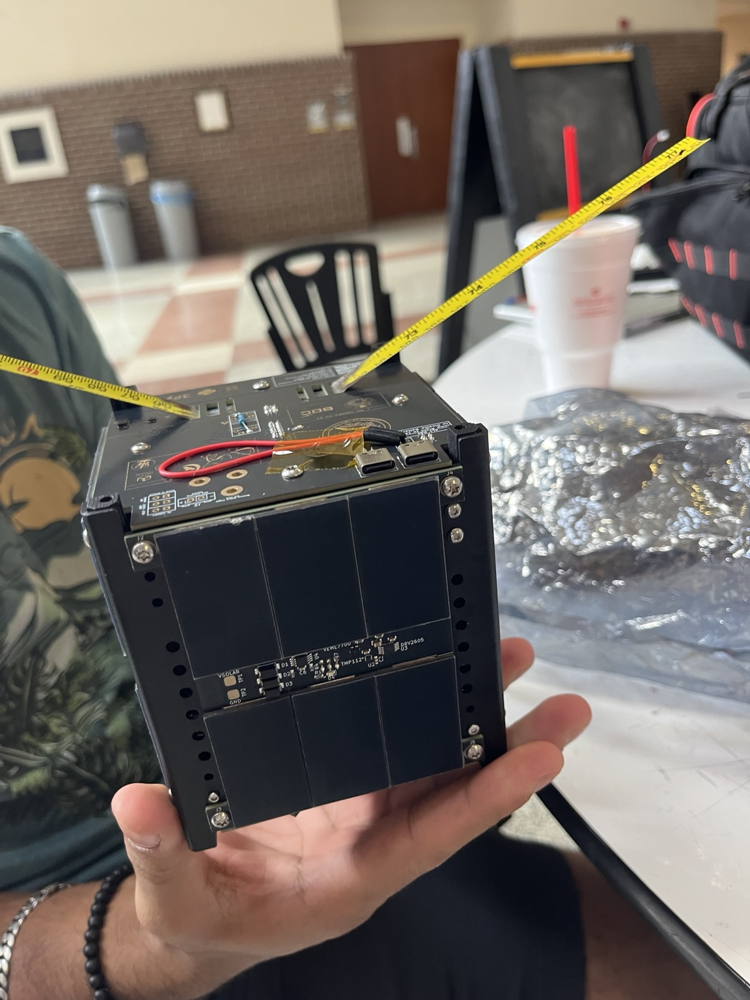
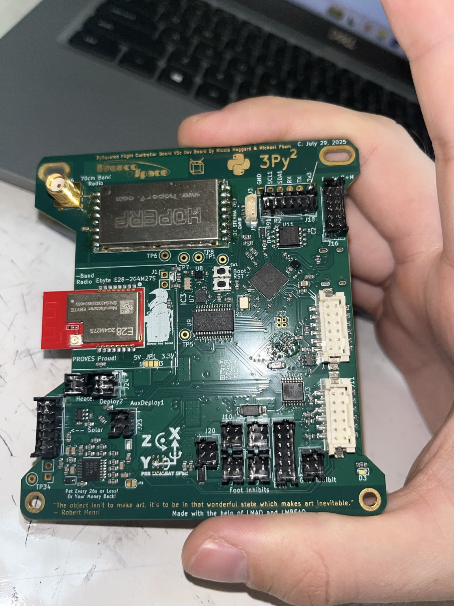

# Orbital CubeSat — KLEO development

Personal engineering repository for work on the Knight's Satellite Club CubeSat
project at the University of Central Florida. This is not the team's official
repository or a flight-ready software release.

The project uses the PROVES platform. Current work here focuses on F Prime,
Zephyr, and bring-up of a **PROVES V5c flight controller**, including an INA260
current, voltage and power sensor driver.

## Project hardware

| Satellite | PROVES V5c flight controller |
| :---: | :---: |
|  |  |
| CubeSat assembly with solar panels and antennas. | V5c flight controller used for development and hardware bring-up. |

## Contents

- [October 14 progress and INA260 driver notes](docs/progress/2026-10-14-ina260.md).

- [Zephyr development status](zephyr/DEVELOPMENT.md): initial F Prime scaffold,
  known build issues, dependency versions and separation from the driver tests.
- [INA260 module](zephyr/modules/kleo-ina260/README.md): driver, devicetree binding,
  standalone V5c sample and build instructions.
- [Simulation tests](zephyr/modules/kleo-ina260/SIMULATION.md): passing core and
  Zephyr driver tests, plus the next steps toward component and system simulation.

The generic Pico2 scaffold is retained as a development checkpoint; it is not a
validated V5c deployment. The INA260 sample builds separately against the V5c
reference board definition. No hardware measurement validation or whole-system
simulation is claimed yet.

## Testing

On the existing WSL development environment:

```sh
bash zephyr/modules/kleo-ina260/test-in-wsl.sh
```

This runs the production C core tests and five Zephyr native simulation tests
without a flight controller. The script currently expects the existing reference
checkout and Python environment described in the module documentation.

Dependencies are recorded using Git submodules and a West manifest rather than
copied into this repository. The standalone driver test uses Zephyr 4.4.2; the
older scaffold manifest uses 4.3.0. They have not yet been unified.

## Hardware and recovery

FC flash backups, telemetry captures and generated firmware are kept outside Git.
The driver has not been tested with a connected INA260. Review board startup,
watchdog and bootloader requirements before any flashing.

Earlier CircuitPython/PySquared notes and the empty Python starter package remain
available in Git history. This repository now documents the F Prime/Zephyr work.
